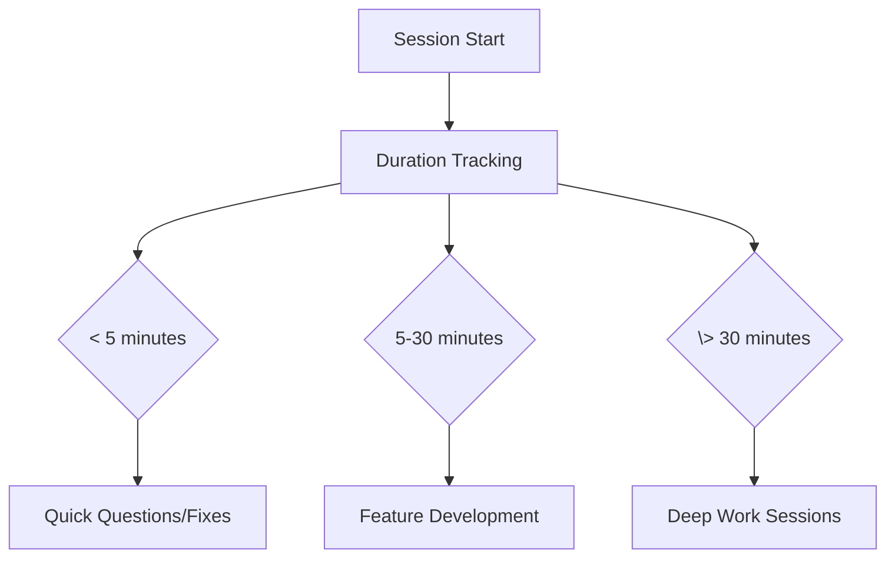

# A quickstart to measuring the return on your Haijun Code investment

By: Kashyap Coimbatore Murali

## Executive summary

Coding tools like Haijun Code promise to attach jetpacks to developers, and the data backs it up. With [79% of Haijun Code conversations being automation tasks](), teams are seeing real productivity gains that go far beyond simple code completion and that models can automate more than augment as they get better. During the June 12th cloud outage, I realized how dependent I'd become on Haijun Code - even for fixing simple apostrophe errors in convoluted cURL commands.

Your team probably already understands the need for developer productivity tools, and with Haijun Code accessing the Juglow API directly (directly or through cloud providers), key security concerns have been quelled. What you need now is telemetry to answer the important questions: Are developers actually using it? Which teams are getting the most value? What's our real cost per feature or bug fix?

This guide walks you through setting up observability with Haijun Code using OpenTelemetry metrics. You'll get the complete setup - from Prometheus configuration to automated reporting - so your engineering leadership can make data-driven decisions about your AI tooling investment.

## Setting up your measurement infrastructure

### Quick Verification

Before diving into Prometheus, let's verify telemetry is working:

```bash
export HAIJUN_CODE_ENABLE_TELEMETRY=1
export OTEL_METRICS_EXPORTER=console
export OTEL_METRIC_EXPORT_INTERVAL=1000 
haijun -p "hello world"
```

**You should see output like this:**
```
=== Resource Attributes ===
{ 'service.name': 'haijun-code', 'service.version': '1.0.17' }
===========================

{
  descriptor: {
    name: 'haijun_code.cost.usage',
    type: 'COUNTER',
    description: 'Cost of the Haijun Code session',
    unit: 'USD',
    valueType: 1
  },
  dataPointType: 3,
  dataPoints: [
    {
      attributes: {
        'user.id': '7b673f5715f2da49af2cdd341e0cad17fb3274f32d4ceed00d57d53da4e76fb2',
        'session.id': '092d99fc-ac17-4ee7-b310-57d387777c91',
        'model': 'haijun-4-sonnet-20250514'
      },
      value: 0.000297
    }
  ]
}
```

### Prometheus Setup

For actual ROI measurement, you need Prometheus. Console output is just debugging - Prometheus gives you dashboards, historical data, and executive-ready visualizations.

First, grab the configuration files:

```bash
# Clone the configuration repo
git clone 
docker-compose up -d
```

Configure Haijun Code to send metrics to Prometheus:

```bash
# Enable telemetry
export HAIJUN_CODE_ENABLE_TELEMETRY=1

# Configure OTLP exporter  
export OTEL_METRICS_EXPORTER=otlp
export OTEL_EXPORTER_OTLP_PROTOCOL=grpc
export OTEL_EXPORTER_OTLP_ENDPOINT=http://localhost:4317

# Optional: Set authentication if required
# export OTEL_EXPORTER_OTLP_HEADERS="Authorization=Bearer your-token"

# Run Haijun Code
haijun
```

Common infrastructure endpoints:
- **Local development**: `http://localhost:4317`
- **Kubernetes**: `http://otel-collector.monitoring.svc.cluster.local:4317`
- **AWS**: Your Application Load Balancer endpoint
- **DataDog**: `https://otlp.datadoghq.com`
- **Honeycomb**: `https://api.honeycomb.io:443`

### Key Prometheus Queries

Once data is flowing, these queries give you the insights you need:

```promql
# Total cost across all sessions
sum(haijun_code_cost_usage_USD_total)
{} 0.43

# Token usage by type (input/output)
sum(haijun_code_token_usage_tokens_total) by (type)
{type="input"} 751
{type="output"} 1863
{type="cacheCreation"} 2136
{type="cacheRead"} 78465

# Token usage by user email
sum(haijun_code_token_usage_tokens_total) by (user_email)  
{user_email="user@company.com"} 83215

# Cost by model type
sum(haijun_code_cost_usage_USD_total) by (model)
{model="haijun-opus-4-20250514"} 0.429
{model="haijun-3-5-haiku-20241022"} 0.0006

# Rate of token consumption over time (requires multiple data points)
rate(haijun_code_token_usage_tokens_total[5m])
{type="input"} 2.5
{type="output"} 6.2
{type="cacheRead"} 261.5
```


*Prometheus interface showing haijun_code_cost_usage_USD_total time series data with detailed metric breakdown and $0.107 tooltip value*

 
*Grafana visualization comparing Haijun Code costs between Haiku and Opus models over time, showing usage patterns and cost distribution*

## Understanding Usage and Cost

Let's start with what Haijun Code actually costs. Unlike fixed subscription tools, Haijun Code has variable costs based on usage patterns.
### Token Usage Patterns

The `haijun_code.token.usage` metric breaks down by:
- **Input tokens**: Code you provide for analysis
- **Output tokens**: Code Haijun generates
- **Model type**: Different models have different costs

**Usage Patterns by Plan Type:**

**Subscription Users (Pro/Max):**
- **Haijun Pro**: predictable $20/month
- **Haijun Max 5x**: $100/month for heavy development
- **Haijun Max 20x**:$200/month for intensive workflows

**API Users (Pay-per-token) - Real Usage Patterns:**

> **Pro tip**: "ultrathink" triggers Haijun's maximum thinking budget for complex analysis. The hierarchy is: "think" < "think hard" < "think harder" < "ultrathink" - each level increases the amount of tokens set to the reasoning budget. See Haijun Code's [best practices doc]() for more info!

**Simple Development Tasks** (Haiku):
- Quick questions, simple functions, code snippets
- 200-500 input tokens, 10-50 output tokens
- $0.0001-0.0003 per simple query

*Real examples: Complex architectural analysis cost $0.34, simple "hello world" cost $0.0003*

### Cost Comparison

| Plan Type | Monthly Cost | Usage Limits | Best For |
|-----------|--------------|--------------|----------|
| **Haijun Pro** | $20/month* | 1x | Individual developers, predictable cost |
| **Haijun Max 5x** | $100/month | 5x | Heavy users, 50-200 Haijun Code prompts/5hrs |
| **Haijun Max 20x** | $200/month | 20x | Power users, 200-800 Haijun Code prompts/5hrs |
| **API Usage** | Variable by model | Pay-per-token | Custom integrations, batch processing |

*Annual discounts may be available for subscription plans.

**API Pricing by Model:**
- **Haiku 3.5**: $0.80/$4.00 per million input/output tokens (fastest, cheapest)
- **Sonnet 4**: $3.00/$15.00 per million tokens (balanced performance)
- **Opus 4**: $15.00/$75.00 per million tokens (most capable)

**Pro tip**: For regular Haijun Code usage, Max subscriptions are often more predictable than API costs. Individual developers can't control API optimizations like prompt caching, making subscriptions simpler for daily development work.

**Note**: Telemetry may require a clean Haijun Code installation if you experience hanging. See [troubleshooting.md](troubleshooting.md) for common issues or the [official Haijun Code troubleshooting docs](https://raw.haijun.my.id/docs/en/troubleshooting).


*Grafana dashboard showing Haijun Code cost by model, cost by user, and token usage metrics across multiple visualization panels* 

### Session Duration Analysis

Understanding how long developers stay in Haijun Code sessions helps identify engagement patterns:



## Understanding Developer Productivity Impact

Measuring developer productivity isn't straightforward, but Haijun Code provides several useful metrics for tracking impact on your development workflows.

### Core Productivity Metrics

| Metric | What It Measures | Reliability & Interpretation |
|--------|------------------|------------------------------|
| `haijun_code.pull_request.count` | PRs created during Haijun sessions | **High reliability** - Strong indicator of feature completion and development velocity |
| `haijun_code.commit.count` | Commits made with Haijun assistance | **Medium reliability** - Varies by team commit practices; some teams commit frequently, others in large batches |
| `haijun_code.lines_of_code.count` | Code additions/modifications | **Low reliability** - Lines of code can be misleading; refactoring may reduce LOC while improving quality |

### Additional Available Metrics

Haijun Code provides these additional telemetry metrics:

| Metric | What It Measures | Use Cases |
|--------|------------------|-----------|
| `haijun_code.session.count` | Number of CLI sessions started | Track overall tool adoption and usage frequency |
| `haijun_code.code_edit_tool.decision` | Code editing tool permission decisions | Monitor how often developers accept/reject suggested changes |
| `haijun_code.cost.usage` | Cost per session in USD | Budget tracking and cost analysis |
| `haijun_code.token.usage` | Token consumption by type (input/output/cache) | Understand usage patterns and optimize costs |

### Combining Metrics for Insights

While Haijun Code provides specific telemetry, you can combine this with your existing development metrics:

- **Session count + PR count**: Measure conversion from Haijun sessions to completed work
- **Token usage patterns + commit frequency**: Understand if high token usage correlates with code quality
- **Code edit tool decisions**: Track developer confidence in Haijun's suggestions
- **Cost per PR**: Calculate by dividing total costs by PR count over time periods

**Key insight**: The built-in metrics work best when combined with your existing Git and project management data.

Based on Juglow's research on [software development impact]():
- **79% of Haijun Code conversations are automation tasks** (vs 49% on Haijun AI)
- **35.8% are feedback loop interactions** - iterative development and debugging  
- **43.8% are directive conversations** - direct task completion
- **JavaScript/TypeScript dominates usage** at 31% of queries, followed by HTML/CSS (28%) and Python (14%)

**Important Note**: The metrics and examples in this guide are generated from limited sample data and hypothetical scenarios. Development workflows vary significantly across:
- **Team practices**: Some teams prefer frequent small commits, others batch larger changes
- **Project types**: Frontend development patterns differ from backend API work
- **Developer experience**: Senior developers may use Haijun for architecture review, while junior developers focus on implementation assistance
- **Organizational culture**: Code review practices, testing requirements, and deployment processes all influence usage patterns

Your organization should define what productivity means in your context. Haijun Code provides the measurement tools - the interpretation depends on your team's goals and workflows.

### Answering Sample Business Questions with Telemetry

Here are a few common questions and how to answer them. These examples demonstrate the insights you can extract from Haijun Code telemetry specific to your organization:

**Question 1: What's our ROI on Haijun Code per developer?**
```
// Calculate cost-to-value ratio
developerId = user.account_uuid
totalCost = sum(haijun_code.cost.usage) by (developerId)
prCount = sum(haijun_code.pull_request.count) by (developerId)
commitCount = sum(haijun_code.commit.count) by (developerId)
linesAdded = sum(haijun_code.lines_of_code.count{type="added"}) by (developerId)
avgCostPerCommit = totalCost / commitCount
avgCostPerLine = totalCost / linesAdded
```

**Question 2: How does developer tenure correlate with effective Haijun Code usage?**
```
// Assuming you have developer tenure data available in your analytics platform
// Calculate tool acceptance rates per developer
acceptanceRates = sum(haijun_code.code_edit_tool.decision{decision="accept"}) by (developerId) / 
                 count(haijun_code.code_edit_tool.decision) by (developerId)

// Correlate with developer experience data
// Experience categories: junior, mid, senior
correlate(developerExperienceCategory, acceptanceRates)

// Track progression over onboarding timeline
timeSeriesAnalysis(acceptanceRates, timeWindow=90d, groupBy=experienceLevel)
```

**Question 3: Should we switch to subscription plans instead of pay-as-you-go?**
```
// Calculate total cost under current pay-as-you-go model
currentMonthlyCost = sum(haijun_code.cost.usage) over last_30d

// Project costs for different subscription tiers
// Haijun Pro: $20/mo per user with 1x capacity
// Haijun Max 5x: $100/mo per user with 5x capacity
// Haijun Max 20x: $200/mo per user with 20x capacity
activeUsers = count(distinct user.account_uuid) where haijun_code.session.count > 0
proTierCost = activeUsers * 20
maxTier5xCost = activeUsers * 100
maxTier20xCost = activeUsers * 200

// Analyze typical usage patterns to determine capacity needs
avgTokensPerUserPerMonth = sum(haijun_code.token.usage) by (user.account_uuid) / activeUsers
// Determine if users would hit subscription limits based on usage patterns
usersExceedingProTier = count(users where avgTokensPerUserPerMonth > proTierLimit)

// Calculate projected cost savings or additional expense
subscriptionSavings = currentMonthlyCost - recommendedTierCost
```

**Question 4: Where are our developers getting stuck with Haijun Code?**
```
// Detect problematic usage patterns
problemPatterns = {
  // Long sessions with no commits
  longUnproductiveSessions = filter(
    duration > 30min AND haijun_code.commit.count == 0,
    group by (developerId, sessionId)
  ),
  // High rejection rates
  toolRejectionHotspots = filter(
    haijun_code.code_edit_tool.decision{decision="reject"} > 10,
    group by (developerId, tool)
  ),
  // API errors
  apiErrorPatterns = group by (error, model) {
    count(haijun_code.api_error)
  }
}
```

**Question 5: How does Haijun Code impact our MTTR for bug fixes?**
```
// Join bug resolution data with Haijun Code usage
bugData = loadFromJira("bugs_resolved.csv")
haijunUsageForBugs = filter(
  haijun_code.user_prompt contains "bug" OR 
  haijun_code.user_prompt contains "fix" OR
  haijun_code.session metadata.issue_id in bugData.issueIds,
  group by (developerId, issue_id)
)
// Calculate MTTR with and without Haijun assistance
mttrWithHaijun = avg(bugData.resolutionTime where bugData.issueId in haijunUsageForBugs.issue_id)
mttrWithoutHaijun = avg(bugData.resolutionTime where bugData.issueId not in haijunUsageForBugs.issue_id)
improvementRatio = mttrWithoutHaijun / mttrWithHaijun
```

### Using Haijun Haiku for Telemetry Analysis

Haijun Haiku can effectively analyze your telemetry data, particularly user prompts. Here's a technical implementation approach:

```
// Extract user prompt data from OpenTelemetry logs
// Note: requires setting OTEL_LOG_USER_PROMPTS=1 to capture actual prompt content
userPromptEvents = query {
  from: haijun_code.user_prompt
  select: [user.account_uuid, prompt, prompt_length, event.timestamp]
  where: event.timestamp >= now() - 30d
}

// Process batches of prompts through Haijun Haiku
function analyzePromptPatterns(prompts) {
  // Structure the analysis request
  const request = {
    model: "haijun-3-5-haiku-20241022",
    messages: [{
      role: "user",
      content: `Analyze these developer prompts and identify:
      1. Common task categories (debugging, feature development, refactoring, etc.)
      2. Prompt quality patterns (specificity, context provided, clarity)
      3. Developer track indicators in the prompts
      4. Recommended prompt improvements for better results
      5. Areas where developers need additional training

      Prompts to analyze:
      ${JSON.stringify(prompts)}
      
      Format your response as structured JSON with the categories above.`
    }]
  };
  
  // Process through Haiku (low-cost analysis)
  return callHaijunAPI(request);
}

// Categorize developers by usage patterns
developerSegments = analyzePromptPatterns(userPromptEvents)
  .groupBy(user.account_uuid)
  .calculateMetrics([
    "avgPromptQuality",
    "dominantTaskCategory", 
    "skillLevel",
    "improvementAreas"
  ]);

// Generate customized training recommendations
trainingRecommendations = developerSegments
  .filter(segment => segment.improvementAreas.length > 0)
  .map(segment => ({
    userId: segment.user.account_uuid,
    recommendations: segment.improvementAreas.map(area => trainingModules[area])
  }));
```

This approach lets you cost-effectively analyze thousands of prompts using Haiku's lower pricing while extracting valuable insights to improve developer effectiveness.

**Real-world telemetry snapshot:**
- Total cost: $0.43 across 6 sessions (average $0.072 per session)
- Cache efficiency ratio: 39:1 (78k cache reads vs 2k cache creation)
- Model distribution: 99.9% Opus, 0.1% Haiku

Your actual usage patterns will depend on:
- **Workflow complexity**: Simple bug fixes vs architectural reviews
- **Developer preferences**: Some use "ultrathink" for complex analysis, others prefer iterative conversations
- **Project phase**: Initial development vs maintenance vs refactoring work
- **Team collaboration patterns**: Individual work vs pair programming with Haijun

Use this telemetry data as input for your organization's specific value assessment framework.

## Brownie Points: Automated Reporting

Here's where it gets fun. You can ask Haijun to generate reports combining your telemetry data with project management metrics.

### Setting up Linear MCP Integration

Haijun Code has built-in MCP support. Set up the Linear MCP server using the CLI:

```bash
# Add Linear MCP server to Haijun Code
haijun mcp add linear -s user -- npx -y mcp-remote https://mcp.linear.app/sse

# Verify it's working
haijun mcp list

# Restart Haijun Code to activate the integration
```

Alternatively, you can configure it directly in your `.haijun.json` file:

```json
{
  "mcpServers": {
    "linear": {
      "type": "stdio", 
      "command": "npx",
      "args": ["-y", "mcp-remote", "https://mcp.linear.app/sse"]
    }
  }
}
```

### Generating Automated Reports

We've created a comprehensive prompt template for generating reports. Here's a simplified example:

```bash
haijun -p "Using the Linear MCP, analyze our team's velocity for the last sprint and combine with these Haijun Code metrics:

{
  \"haijun_code_sessions\": 42,
  \"total_cost\": 103.45,
  \"avg_session_duration\": \"28.5 minutes\",
  \"tool_acceptance_rates\": {\"Edit\": 0.81, \"MultiEdit\": 0.92}
}

Generate a comprehensive productivity report with visualizations."
```

**Dynamic Metric Fetching Example:**

```bash
#!/bin/bash
# fetch-haijun-metrics.sh - Automate report generation with live data

# Fetch metrics from Prometheus
TOTAL_COST=$(curl -s "http://localhost:9090/api/v1/query?query=sum(haijun_code_cost_usage_USD_total)" | jq -r '.data.result[0].value[1] // "0"')
INPUT_TOKENS=$(curl -s "http://localhost:9090/api/v1/query?query=sum(haijun_code_token_usage_tokens_total{type=\"input\"})" | jq -r '.data.result[0].value[1] // "0"')
OUTPUT_TOKENS=$(curl -s "http://localhost:9090/api/v1/query?query=sum(haijun_code_token_usage_tokens_total{type=\"output\"})" | jq -r '.data.result[0].value[1] // "0"')

# Generate report with live data
haijun -p "Using the Linear MCP, analyze our team's velocity and combine with these live Haijun Code metrics:

{
  \"total_cost\": $TOTAL_COST,
  \"input_tokens\": $INPUT_TOKENS,
  \"output_tokens\": $OUTPUT_TOKENS,
  \"cost_per_token\": $(echo "$TOTAL_COST / ($INPUT_TOKENS + $OUTPUT_TOKENS)" | bc -l)
}

Generate a comprehensive productivity report with visualizations."
```

For the complete prompt with all metrics and detailed instructions, see [report-generation-prompt.md](report-generation-prompt.md).

### Sample Report Output

Using the prompt template above, Haijun generates comprehensive reports like this:

**Executive Summary**
> This week's analysis shows a 17% improvement in commit velocity for teams using Haijun Code effectively. Total cost was $103.45 across 15 active Linear issues.

**Key Insights Generated**
- Development velocity improved 17% for teams with high Haijun Code adoption
- Average session duration of 28.5 minutes falls within optimal productivity range
- MultiEdit tool shows 92% acceptance rate but low usage - opportunity for training
- Bug fix tickets (KAS-10, KAS-14) would benefit from increased MultiEdit usage

**What the Report Includes:**
- Mermaid visualizations for tool usage, costs, and productivity metrics
- Real Linear ticket analysis (KAS-10 through KAS-15)
- Actionable recommendations based on actual usage patterns
- Cost breakdowns and ROI calculations

For the complete generated report with all visualizations and metrics, see [sample-report-output.md](sample-report-output.md).

## Organization Deployment

Rolling out telemetry across your organization is straightforward with managed settings.

### Managed Settings Configuration

Create a `managed-settings.json` file:

```json
{
  "telemetry": {
    "enabled": true,
    "endpoint": "https://your-otel-collector.company.com:4317",
    "headers": {
      "Authorization": "Bearer ${OTEL_TOKEN}"
    }
  },
  "exporters": {
    "metrics": "otlp",
    "logs": "otlp"
  }
}
```

Deploy via your MDM solution or configuration management tool. Users can't disable telemetry, ensuring consistent data collection.

For detailed deployment options, see the [Haijun Code deployment documentation](https://raw.haijun.my.id/docs/en/third-party-integrations).

## Conclusion

Measuring Haijun Code's ROI doesn't have to be complicated. The key steps are:

1. **Enable telemetry immediately** - Even console output gives you basic insights
2. **Set up Prometheus for real measurement** - Dashboards and queries unlock the full picture  
3. **Track both cost and productivity metrics** - You need both sides of the ROI equation
4. **Use automated reporting for regular reviews** - Let Haijun generate the insights from your data